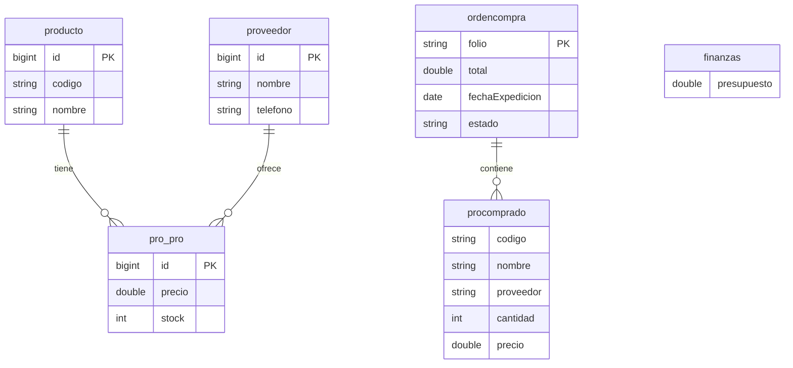

# AdminCompras — Java + MySQL

Sistema de gestion de compras para materia de diseno de software: proveedores, cotizaciones, ordenes de compra, inventario y finanzas. Arquitectura por subsistemas con capas Negocio y Persistencia.

## Stack

`Java`, `Maven`, `MySQL` + `EclipseLink JPA`, `MongoDB` (persistencia alterna), `JUnit`

## Arquitectura

- App principal `AdiminCompras` que orquesta subsistemas por fachadas.
- Capas: Negocio (`AdminCompras_Negocio`, `NegocioBO`) y Persistencia (`AdminCompras_Persistencia` + Mock para pruebas).
- Cada subsistema es un modulo Maven con su fachada e interfaces propias.

| Subsistema | Que cubre |
| --- | --- |
| GenerarOrden | Creacion de ordenes de compra |
| Cotizaciones | Cotizaciones de proveedores |
| Proveedores | Alta y consulta de proveedores y sus productos |
| Inventario / InventarioBajo | Entradas, salidas y stock bajo |
| Finanzas | Presupuesto y pagos |
| InicioSesion | Acceso de usuarios |
| ConsultarProductos / ConsultarProveedores | Busquedas y coincidencias |
| ProductosComprados / LlenarTabla | Historial y llenado de tablas |

## Base de datos

Modelo relacional en MySQL (`BD.sql`: base `adminCompras`), reconstruido desde las entidades del codigo. `pro_pro` es la union producto-proveedor con precio y stock. `ordencompra` embebe sus productos comprados.



## Como correrlo

```bash
git clone https://github.com/Morales241/DisenoSoftware.git
# Crear la base adminCompras en MySQL y ajustar persistence.xml
# mvn package en cada modulo, luego correr AdiminCompras
```

Abrir en NetBeans o IntelliJ como proyectos Maven, configurar la conexion en `persistence.xml` y ejecutar el modulo principal.
